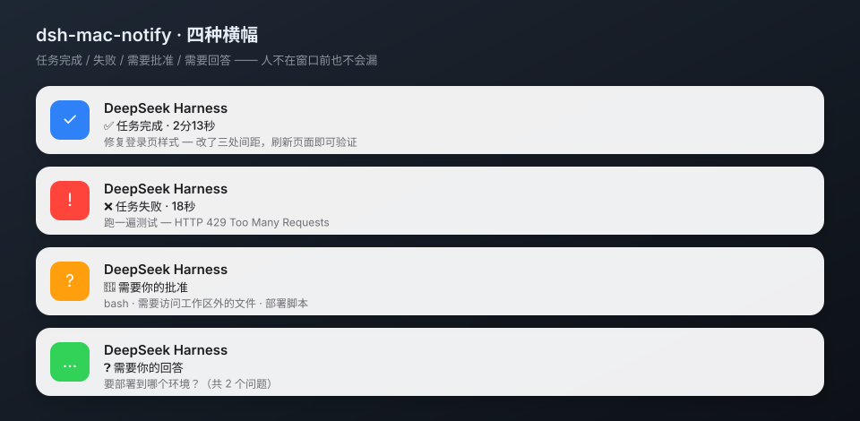

# dsh-mac-notify

Native **macOS notifications** for [DeepSeek Harness (DSH)](https://github.com/deepseek-ai): a banner appears when a task completes, fails, needs your approval, or needs an answer — so you do not have to babysit the window.

[中文说明](./README.zh.md)



## What it notifies

| Moment | DSH event | Banner |
| --- | --- | --- |
| ✅ Task complete | `turn/end` → `completed` | duration + your prompt (+ last answer line) |
| ❌ Task failed | `turn/end` → `error` / `max-tokens` | error message + task |
| 🔐 Approval needed | `approval/request` | tool name + reason |
| ❓ Answer needed | `user-questions/request` | the question text (count when several) |
| 📋 Plan awaiting review | `user-questions/request` with `plan-review` | dedicated subtitle |
| ⏸ Task blocked | `turn/end` → `blocked` | off by default |

Subagent turns are **silent by default**: every subagent ends turns constantly and would spam you; only the session you are watching announces itself.

## Install

### Desktop app (DeepSeek Harness.app)

The desktop profile is managed exclusively by the Electron app, so `dsh plugin --profile desktop ...` is refused. Use **Plugins → Install** in the sidebar with:

```text
link:/absolute/path/to/dsh-mac-notify     # local checkout
github:CarbeneLee/dsh-mac-notify          # straight from GitHub
```

The desktop app ships HMR, so the bundle usually mounts **without a restart**; quit and reopen the app only if no banner appears.

### Web profile / custom profiles (CLI)

```sh
dsh plugin --profile web add github:CarbeneLee/dsh-mac-notify
```

### Manual wiring

Add the dependency and the bundle to `~/.dsh/profiles/<profile>/package.json`:

```json
{
  "dependencies": { "dsh-mac-notify": "link:/path/to/dsh-mac-notify" },
  "dsh": { "profile": { "bundles": ["...", "dsh-mac-notify"] } }
}
```

Then install inside the profile with the pnpm the app ships:

```sh
cd ~/.dsh/profiles/desktop
node "/Applications/DeepSeek Harness.app/Contents/Resources/runtime/primary-runtime/dependencies/pnpm/bin/pnpm.mjs" install
```

## Verify

1. System notifications first, no plugin needed:
   ```sh
   node scripts/notify-demo.mjs
   ```
2. With the plugin mounted, ask "send a test notification" — the model calls `mac_notify_test` and returns the active backend and config.
3. Set `debug: true` to append every delivery to `~/.dsh/dsh-mac-notify/debug.log`.

## Configure

Overrides live in the profile's `cordis.patch.yml`:

```yaml
- id: dsh-mac-notify
  config:
    appName: DeepSeek Harness
    notifyOnComplete: true
    notifyOnError: true
    notifyOnApproval: true
    notifyOnQuestion: true
    suppressWhenFocused: false
    backend: osascript
    completeSound: Glass
    debug: false
```

| Field | Default | Meaning |
| --- | --- | --- |
| `enabled` | `true` | master switch |
| `appName` | `DeepSeek Harness` | banner title, and the app name used for focus suppression |
| `bundleId` | `com.deepseek.dsh` | app activated on click |
| `locale` | `auto` | `zh` / `en`, auto reads `LANG` |
| `notifyOnComplete` | `true` | task complete |
| `notifyOnError` | `true` | failure / output limit |
| `notifyOnApproval` | `true` | approval requests |
| `notifyOnQuestion` | `true` | questions, choices, plan review |
| `notifyOnBlocked` | `false` | blocked turns |
| `includeSubagents` | `false` | include subagent turns (noisy) |
| `suppressWhenFocused` | `false` | skip while the DSH window is frontmost |
| `completeSound` | `Glass` | macOS sound name |
| `errorSound` | `Basso` | |
| `approvalSound` | `Ping` | |
| `questionSound` | `Ping` | |
| `completeSoundFile` | `""` | audio file for the tone; wins over the named sound |
| `errorSoundFile` | `""` | |
| `approvalSoundFile` | `""` | |
| `questionSoundFile` | `""` | |
| `backend` | `osascript` | see below |
| `command` | `""` | command for `backend: command` |
| `minIntervalMs` | `300` | throttle for burst notifications |
| `maxBodyChars` | `220` | body budget |
| `maxLabelChars` | `70` | task label budget |
| `debug` | `false` | write `debug.log` |

Sound names are the system ones (`Glass`, `Ping`, `Basso`, `Submarine`, `Hero`, …); `""` is silent.

## Reuse another app's tone (WeChat / QQ)

`*SoundFile` accepts anything `afplay` can play (caf / aiff / wav / mp3), so the notification can sound exactly like WeChat:

```sh
mkdir -p ~/.dsh/dsh-mac-notify/sounds
cp /Applications/WeChat.app/Contents/Resources/notify.caf \
   ~/.dsh/dsh-mac-notify/sounds/wechat-notify.caf
```

```yaml
- id: dsh-mac-notify
  config:
    completeSoundFile: "~/.dsh/dsh-mac-notify/sounds/wechat-notify.caf"
    errorSoundFile: "~/.dsh/dsh-mac-notify/sounds/wechat-notify.caf"
    approvalSoundFile: "~/.dsh/dsh-mac-notify/sounds/wechat-notify.caf"
    questionSoundFile: "~/.dsh/dsh-mac-notify/sounds/wechat-notify.caf"
```

Copy the file into your own directory instead of referencing the app bundle, so an app update cannot break it. Each event may use its own tone; empty falls back to the named system sound.

## Backends

| backend | Notes |
| --- | --- |
| `osascript` (default) | `display notification`, zero dependencies, works from any macOS process; Notification Center attributes it to Script Editor |
| `electron` | native Electron notification: attributed to DeepSeek Harness, click activates the app. Only works where the plugin host can load the `electron` module — the shipped DSH desktop build (Electron 44) does not expose it to plugins, so this backend falls back (see the debug log) |
| `terminal-notifier` | if `brew install terminal-notifier` is present; supports grouping |
| `command` | pipe to your own command; the payload arrives as `DSH_NOTIFY_TITLE/SUBTITLE/BODY/SOUND/GROUP` |
| `auto` | Electron → terminal-notifier → osascript |

`command` example (webhook, `noti`, a script of yours):

```yaml
backend: command
command: 'curl -s -X POST -H "Content-Type: application/json" -d "{\"text\":\"$DSH_NOTIFY_BODY\"}" https://example.com/hook'
```

## Troubleshooting

- **No banner**: System Settings → Notifications → allow **Script Editor** (osascript backend) or **DeepSeek Harness** (electron backend); check Focus / Do Not Disturb.
- **Nothing after install**: restart the desktop app; confirm `dsh-mac-notify` is in `dsh.profile.bundles` of `~/.dsh/profiles/desktop/package.json`.
- **Completion works, approvals do not**: approvals only exist under the `ask` policy; the banner is emitted regardless of whether an answerer takes the request.
- **Privacy**: banner text also shows on the lock screen. It contains the first line of your prompt, tool names and question text — lower `maxBodyChars` or switch events off if that matters.

## How it works

Host-only, zero runtime dependencies; it reads no files and opens no sockets:

```text
approval/request       ──┐
user-questions/request ──┼──► compose banner ──► sender.send() ──► Notification Center
session/event turn/end ──┘                        ├─ electron Notification
                                                  ├─ terminal-notifier
                                                  ├─ osascript
                                                  └─ custom command
```

- Listeners register with `{ global: true, prepend: true }`, send the banner, then hand the request back with `next()` — approval outcomes are never changed, and a failing notification can never block a task.
- Each turn remembers the first human prompt and the last answer, which become the banner text.
- Delivery is fire-and-forget; errors only reach the debug log.

## Development

```sh
npm test                      # 18 node:test cases, no DSH required
node scripts/notify-demo.mjs  # send a real notification
```

```text
dsh/index.js    event routing + wording
dsh/notify.js   backends (osascript / electron / terminal-notifier / command)
dsh/config.js   defaults and validation
dsh/text.js     clamping and duration formatting
test/           node:test suite
```

## Limitations

- macOS only; other platforms skip silently.
- `osascript` banners have no click action; use `backend: electron` for click-to-activate.
- Profile changes hot-apply through HMR; a restart is the fallback when a re-composition is refused.
- Notifications carry no window identity: every session in the profile shares one stream.

## License

MIT
