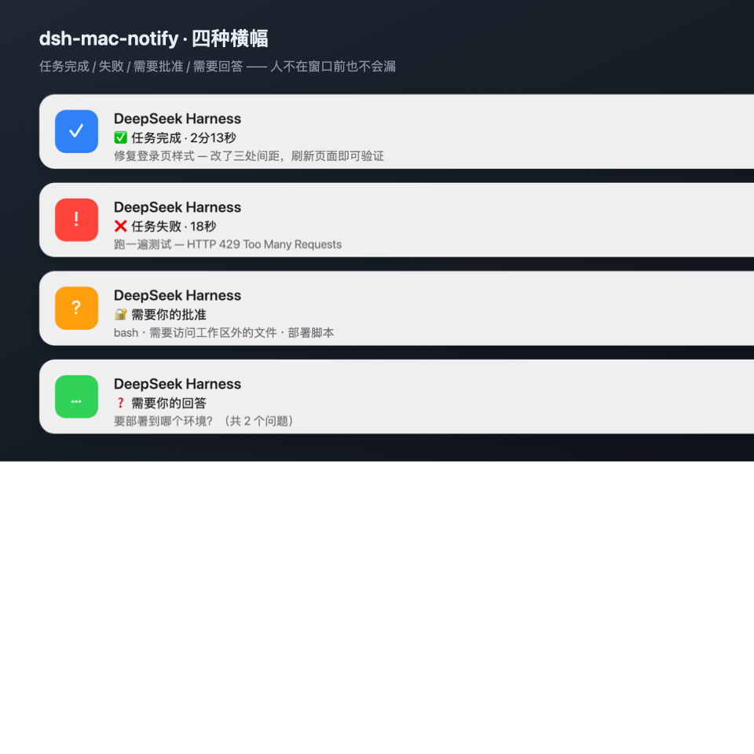

# dsh-mac-notify

把 [DeepSeek Harness (DSH)](https://github.com/deepseek-ai) 的关键时刻变成 **macOS 原生通知**：任务完成、任务失败、需要你批准、需要你回答或做选择时，Mac 右上角弹出横幅，人不用一直盯着窗口。

[English](./README.md)



> 仅支持 macOS。`package.json` 里已声明 `dsh.bundle.platforms: ["darwin"]`，Windows / Linux 宿主会跳过这个 bundle，不会装上一个空转的插件。

## 它能通知什么

| 时机 | 触发的 DSH 事件 | 通知内容 |
| --- | --- | --- |
| ✅ 任务完成 | `turn/end` → `completed` | 用时 + 你最初的任务（+ 最后一句回答） |
| ❌ 任务失败 | `turn/end` → `error` / `max-tokens` | 错误信息 + 任务标题 |
| 🔐 需要批准 | `approval/request` | 工具名 + 申请原因 |
| ❓ 需要你回答/选择 | `user-questions/request` | 问题原文（多个问题时标注数量） |
| 📋 计划待确认 | `user-questions/request` + `plan-review` | 计划确认单独一种标题 |
| ⏸ 任务被阻塞 | `turn/end` → `blocked` | 默认关闭，可开启 |

默认**静音子代理**：子代理每一轮结束都会 `turn/end`，如果全量通知会刷屏；只有你正在看的那个会话结束才会响。

## 安装

> 需要 macOS + 已安装的 DSH 桌面版或 Web 版。

### 桌面版（DeepSeek Harness.app）

桌面 profile 由应用独占管理，`dsh plugin --profile desktop ...` 会被拒绝。请用侧边栏 **插件 → 安装**，填：

```text
link:/绝对路径/dsh-mac-notify        # 本地开发
github:CarbeneLee/dsh-mac-notify     # 直接从 GitHub 安装
```

桌面版默认开着 HMR，安装后通常**无需重启**就会自动挂载；如果横幅没出现，退出重开一次应用即可。

### Web 版 / 自定义 profile（CLI）

```sh
dsh plugin --profile web add dsh-mac-notify                    # 从 npm 安装（推荐）
dsh plugin --profile web add github:CarbeneLee/dsh-mac-notify  # 或直接用 GitHub 源
```

装好后默认走 `backend: auto`：先试 Electron 原生、再试原生 helper、再试 terminal-notifier，最后退回 osascript。**首次挂载时如果没有 `DSHNotifier.app`，插件会自动在后台构建一次**（需要 Xcode 命令行工具，几秒钟）；构建完成前通知照常由 osascript 投递，只是图标暂时是脚本编辑器的。想关掉自动构建就设 `DSH_MAC_NOTIFY_NO_BUILD=1`。

### 手动装配（不想用插件管理器）

在 `~/.dsh/profiles/<profile>/package.json` 里加依赖并把它加进 `dsh.profile.bundles`：

```json
{
  "dependencies": { "dsh-mac-notify": "link:/path/to/dsh-mac-notify" },
  "dsh": { "profile": { "bundles": ["...", "dsh-mac-notify"] } }
}
```

然后在 profile 目录跑一次安装（用 DSH 自带的 pnpm）：

```sh
cd ~/.dsh/profiles/desktop
node "/Applications/DeepSeek Harness.app/Contents/Resources/runtime/primary-runtime/dependencies/pnpm/bin/pnpm.mjs" install
```

## 验证

1. 不装插件也能先验证「系统通知通不通」：
   ```sh
   node scripts/notify-demo.mjs
   ```
2. 插件挂载后，在会话里说「发个测试通知」，模型会调用 `mac_notify_test`，返回当前后端与配置。
3. 打开调试日志：配置 `debug: true`，日志写到 `~/.dsh/dsh-mac-notify/debug.log`。

## 配置

配置写在 profile 的 `cordis.patch.yml`（不是改插件仓库里的文件）：

```yaml
- id: dsh-mac-notify
  config:
    appName: DeepSeek Harness
    notifyOnComplete: true
    notifyOnError: true
    notifyOnApproval: true
    notifyOnQuestion: true
    suppressWhenFocused: false
    backend: osascript
    completeSound: Glass
    debug: false
```

| 字段 | 默认值 | 说明 |
| --- | --- | --- |
| `enabled` | `true` | 总开关 |
| `appName` | `DeepSeek Harness` | 通知标题；也是「焦点免打扰」比较的应用名 |
| `bundleId` | `com.deepseek.dsh` | 点击通知时激活哪个 App |
| `locale` | `auto` | 文案语言 `zh` / `en`，auto 读 `LANG` |
| `notifyOnComplete` | `true` | 任务完成 |
| `notifyOnError` | `true` | 任务失败 / 输出达上限 |
| `notifyOnApproval` | `true` | 需要批准 |
| `notifyOnQuestion` | `true` | 需要回答 / 选择 / 确认计划 |
| `notifyOnBlocked` | `false` | 任务被阻塞 |
| `includeSubagents` | `false` | 子代理也通知（会很多） |
| `suppressWhenFocused` | `false` | DSH 窗口在前台时不打扰 |
| `completeSound` | `Glass` | 完成提示音（macOS 声音名） |
| `errorSound` | `Basso` | 失败提示音 |
| `approvalSound` | `Ping` | 批准提示音 |
| `questionSound` | `Ping` | 提问提示音 |
| `completeSoundFile` | `""` | 音频文件当提示音，优先于上面的系统声音名 |
| `errorSoundFile` | `""` | 同上 |
| `approvalSoundFile` | `""` | 同上 |
| `questionSoundFile` | `""` | 同上 |
| `backend` | `auto` | 见下方「投递后端」 |
| `helperPath` | `""` | helper 可执行文件路径，默认 `$DSH_HOME/dsh-mac-notify/DSHNotifier.app/...` |
| `command` | `""` | `backend: command` 时执行的命令 |
| `minIntervalMs` | `300` | 同一类通知的最小间隔，避免连发 |
| `maxBodyChars` | `220` | 正文最大字数 |
| `maxLabelChars` | `70` | 任务标题最大字数 |
| `debug` | `false` | 写调试日志 |

声音名就是系统里的那套：`Glass`、`Ping`、`Basso`、`Submarine`、`Hero`…，填 `""` 静音。

## 自定义提示音（微信 / QQ 同款）

`*SoundFile` 支持任意 `afplay` 能播的音频（caf / aiff / wav / mp3），所以可以直接借用别的 App 的提示音。以微信 macOS 版的「叮」为例：

```sh
mkdir -p ~/.dsh/dsh-mac-notify/sounds
cp /Applications/WeChat.app/Contents/Resources/notify.caf \
   ~/.dsh/dsh-mac-notify/sounds/wechat-notify.caf
```

```yaml
- id: dsh-mac-notify
  config:
    completeSoundFile: "~/.dsh/dsh-mac-notify/sounds/wechat-notify.caf"
    errorSoundFile: "~/.dsh/dsh-mac-notify/sounds/wechat-notify.caf"
    approvalSoundFile: "~/.dsh/dsh-mac-notify/sounds/wechat-notify.caf"
    questionSoundFile: "~/.dsh/dsh-mac-notify/sounds/wechat-notify.caf"
```

- 复制到自己的目录而不是直接引用 App 包内路径，App 升级/搬走后不会失联。
- 四个事件可以各用各的声音；留空则回落到 `completeSound` 那套系统声音名。
- QQ macOS 版没有可直接提取的消息提示音（打包在资源里），微信 `notify.caf` 是最省事的同款选择；也可以放任何自己喜欢的音频。

## 投递后端

| backend | 说明 |
| --- | --- |
| `helper`（推荐） | 用仓库里的 `DSHNotifier.app` 发通知：**显示 DSH 的图标**，点击横幅会唤起 DeepSeek Harness。需要先 `sh scripts/build-helper.sh` 构建一次 |
| `osascript` | `display notification`，零依赖，任何 macOS 进程都能用；但图标归属「脚本编辑器」，点击没有任何反应 |
| `electron` | Electron 原生通知，归属「DeepSeek Harness」、点击可唤起应用；只在插件宿主拿得到 `electron` 模块时有效——实测本机 DSH 桌面版（Electron 44）不给插件暴露该模块，会自动降级（debug 日志会写明） |
| `terminal-notifier` | 已装 `brew install terminal-notifier` 时可用，支持分组 |
| `command` | 自己接一条命令，payload 走环境变量 `DSH_NOTIFY_TITLE/SUBTITLE/BODY/SOUND/GROUP` |
| `auto`（默认） | Electron → helper → terminal-notifier → osascript 逐级降级 |

`command` 示例（接飞书自定义机器人、`noti`、自研脚本都行）：

```yaml
backend: command
command: 'curl -s -X POST -H "Content-Type: application/json" -d "{\"text\":\"$DSH_NOTIFY_BODY\"}" https://example.com/hook'
```

## 图标与点击（helper 后端）

macOS 的通知图标**只能来自发通知的 App 本身**：AppleScript 走「脚本编辑器」，terminal-notifier 3.x 也删掉了 `-appIcon`（系统不允许覆盖）。所以仓库里带了一个极小的原生 App——`DSHNotifier.app`：

- 它借用 DeepSeek Harness 的 `icon.icns`，所以横幅图标就是 DSH 那个蓝鲸标；
- 点击横幅会启动它，它把 DeepSeek Harness 唤到前台后立刻退出（不会常驻、没有 Dock 图标）；
- 首次发通知时，系统会问一次「DeepSeek Harness 想给你发送通知」，点允许即可（在「系统设置 → 通知」里也能看到它）。

构建（只需要一次，需要 Xcode 命令行工具）：

```sh
sh scripts/build-helper.sh          # 默认装到 ~/.dsh/dsh-mac-notify/DSHNotifier.app
```

然后在 profile 配置里打开：

```yaml
- id: dsh-mac-notify
  config:
    backend: helper
```

> **关于「跳到对应会话」**：DSH 目前没有会话级的深链（`dsh://` 只注册了协议名，桌面端没有对应的 URL 处理），所以点击只能把 App 唤到前台，停在它上次所在的页面。等 DSH 提供深链能力后，只要在 helper 里改一行就能精确跳转。

## 排查

- **没有横幅**：系统设置 → 通知 → 找到「脚本编辑器」（osascript 后端）或「DeepSeek Harness」（electron 后端），打开「允许通知」，并确认没开「专注模式」。
- **装完没反应**：桌面版必须重启应用；确认 `~/.dsh/profiles/desktop/package.json` 的 `dsh.profile.bundles` 里有 `dsh-mac-notify`。
- **只有完成通知、没有批准通知**：确认会话是 `ask` 批准策略（通知在批准链路最前面发出，与是否有人回答无关）。
- **隐私**：通知正文会出现在锁屏和通知中心，包含任务首行、工具名、问题原文。介意就把 `maxBodyChars` 调小，或关掉对应开关。

## 工作原理

插件是 host-only、零运行时依赖，只监听三个核心事件，不读文件、不联网：

```text
approval/request       ──┐
user-questions/request ──┼──► 组装文案 ──► sender.send() ──► macOS 通知中心
session/event turn/end ──┘                 ├─ electron Notification
                                           ├─ terminal-notifier
                                           ├─ osascript
                                           └─ 自定义 command
```

- 监听器用 `{ global: true, prepend: true }` 注册，通知先发出、再把请求交回原有回答链（`next()`），不会改变批准结果，也不会因为通知失败而阻断任务。
- 每轮对话会记录「首个人类 prompt」和「最后一句回答」，用来生成任务标题。
- 所有投递都在 fire-and-forget 分支里，异常只写日志。

## 开发

```sh
npm test                      # 18 个 node:test 用例，不需要 DSH
node scripts/notify-demo.mjs  # 真实发一条通知
```

目录：

```text
dsh/index.js    事件路由 + 文案
dsh/notify.js   投递后端（osascript / electron / terminal-notifier / command）
dsh/config.js   配置默认值与校验
dsh/text.js     文本裁剪、时长格式化
test/           node:test 用例
```

## 已知限制

- 只在 macOS 生效；其他平台静默跳过（不报错）。
- `osascript` 后端的通知没有点击动作；想要点击唤起应用请用 `backend: electron`。
- Profile 改动一般由 HMR 热挂载；极少数情况下需要重启应用才会重新组合。
- 通知不区分「哪个窗口」，同一 profile 的所有会话共用一个通知流。

## License

MIT
